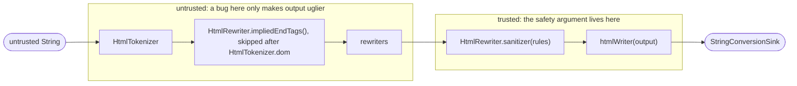

# Design of `package:sanitize_html`

This document explains the opinions baked into the package and why they hold.
The README says what the package does; this says why it is shaped the way it
is, and exactly which code a reviewer has to trust.

## The one idea

Most HTML sanitizers try to *recognize* dangerous input, which means modelling
every quirk of every HTML parser, forever. This package instead only ever
*produces* output from a small, closed grammar in which text cannot become
markup, and a single writer owns that grammar. The question "is this input
dangerous?" becomes "can this output grammar express anything dangerous?" — a
question about a few hundred lines of our own code, answered once, with
references to the spec.

Everything else in the design follows from protecting that property.

## Pipeline



Each arrow between tokenizer and writer is an `HtmlTokenSink`.

Everything between tokenizer and writer is an `HtmlRewriter`: a value that
wraps the next `HtmlTokenSink` in a sink of its own (`bind(sink)`). It is a
class rather than a function type so that the built-in rewriters are its
named constructors and a custom one is `HtmlRewriter(MySink.new)`.
`a.fuse(b)` runs `a` then `b`; `[a, b].fuse()` (the `HtmlRewriters`
extension) folds a list, an empty one being `HtmlRewriter.identity()`.
`sanitizeHtml` is exactly:

```dart
[
  if (!tokenizer.buildsTree) HtmlRewriter.impliedEndTags(),
  ...rewriters,
  HtmlRewriter.sanitizer(rules ?? RuleSet.gfm()),
].fuse().bind(htmlWriter(output))
```

Order matters in exactly one place: the sanitizer is last. Everything before
it is filtered by the rules; anything after it would have to be trusted, so
there is nothing after it.

## The trusted surface

The guarantee rests on these files and nothing else. Reviewing the package for
safety means reviewing these.

| File | What it decides | Why it must be trusted |
|---|---|---|
| `lib/src/html_writer.dart` | The output grammar: escaping, name alphabets, void elements, balancing, depth, closing. | It is the only code that writes output. If it is correct, the browser creates no element or attribute that was not pushed into it. |
| `lib/src/url_policy.dart` | Which strings may be the value of a URL attribute, and what `Uri` user code sees. | A `javascript:` URL is a valid attribute value to the writer; only the policy stops it. |
| `lib/src/attribute_rule.dart` | How each `AttributeRule` keeps or drops a value; which rules count as URL-, `srcset`- and `rel`-restricted. | It is where the URL policy is invoked. A bug here could keep a value the policy rejected, or let a grant check pass. |
| `lib/src/element_rule.dart`, `lib/src/element_pattern.dart` | Which attributes a rule keeps; when a pattern matches and what it keeps. | They decide what reaches the writer for an element. |
| `lib/src/rule_set.dart` | Which elements have rules and exemptions, how rule sets combine, that every name and grant is checked at construction. | A combination that widened a grant would bypass the checks. |
| `lib/src/grant_assertions.dart` | What a checked `RuleSet()` refuses to allow. | This is the list that turns "the browser creates nothing extra" into "no script runs". |
| `lib/src/rules/*` | The default allowlists: `gfm.dart`, `html.dart`, `link_types.dart`. | Policy data. No logic, but a wrong entry is a wrong default. |
| `lib/src/sanitizer.dart` | That every token reaching the writer passed through the rules. | Trusted for *completeness* only; it writes nothing itself. |

Explicitly **not** trusted, by design:

* `lib/src/tokenizer/*` — three interchangeable tokenizers. Whatever they
  report, unknown elements are unwrapped and all text is escaped. They are
  reviewed for termination, linear time and fidelity, not for safety. The
  character-reference decoder is in this group too: the writer re-escapes
  attribute values exactly, so the URL policy sees the same string the
  browser will.
* `lib/src/rewriters/*` — the built-in `HtmlRewriter`s,
  `implied_end_tags.dart` included. They run before the sanitizer and so can
  only ever add things that the rules then filter.
* `lib/src/html_rewriter.dart`, `lib/src/delegating_html_token_sink.dart` —
  plumbing: the rewriter class and the forwarding base of rewriter sinks.
* `lib/src/util/*` — named ASCII code units (`$lt`, `$amp`, ...) and
  predicates, the space-separated-token splitter. Pure functions shared by
  trusted and untrusted code; small enough to read in a minute.

## The promise, stated carefully

> For output inserted where an HTML parser is in the *data state*, the
> browser creates **no element and no attribute that was not pushed into the
> writer**.

It is a *subset* claim, not an equality. A rule set that allows `<plaintext>`
will see the browser turn everything after it — our own end tags included —
into text. The browser created *fewer* nodes than we wrote. That is a
rendering bug for the author of a strange rule set, not a safety bug, and the
writer deliberately does not try to prevent it. The one exception is `image`,
which the tree builder turns into `img` — an element nobody pushed — so the
writer refuses it.

The proof sketch lives as the library comment of `html_writer.dart`,
point by point with links to the tokenizer states involved. It is short on
purpose: a 30-minute auditor should be able to follow it end to end.

On top of it, a checked `RuleSet()` promises three more things, which are what
the grant assertions exist to keep:

* no script runs in the page's origin;
* no control over the host document, navigating it included (which is why
  `rel=opener` is refused);
* no URL outside the URL policy.

## Opinions, and why

### The writer owns the grammar, and only the grammar

The writer's only opinions are: escape text, quote and escape values,
restrict name alphabets, know the void elements, balance, cap depth, refuse
`image`, close everything on `close()`. It has no list of forbidden elements
and no idea what `on*` means.

Whether `<script>` is acceptable is a *policy* question; whether `<scr ipt>`
can be written is a *grammar* question. Keeping them apart keeps the safety
argument in two independent halves: "the browser sees exactly what was
written" holds unconditionally and is argued from the tokenizer spec alone;
"the rules grant nothing dangerous" holds for checked rule sets and is argued
from a short list. If the writer also carried a forbidden list, the first
half would become "the writer is safe given this list", the list would have
to be kept in sync with the rules, and the writer would need to know about
SVG, forms and `iframe`. For the same reason the writer is not called
*safe*: it will happily write `<script>` if asked, and is safe only together
with a checked rule set.

`htmlWriter(output)` returns a private sink: there is nothing to subclass or
configure. A token after `close()` throws, so a pipeline that keeps feeding a
finished writer fails in tests rather than emitting a second, unbalanced
document.

### Names that break the grammar throw

A tag or attribute name outside `[a-z][a-z0-9._-]*` / `[a-z][a-z0-9_:.-]*`
throws `ArgumentError` rather than being skipped. A bad name is a contract
violation by whatever feeds the writer, and throwing surfaces it in tests.
It can never depend on input: a `RuleSet` validates every name at
construction (rules, pattern `match` and pattern `attributes` alike), so the
sanitizer only ever passes names the writer accepts, including the `image`
check, which both `RuleSet` constructors share.

### Rules filter; rewriters rewrite

An `AttributeRule` maps a value to *keep* or *drop*. It never changes a value,
not even by removing tokens from a `class` list. That makes a rule a plain
predicate on values, and combining rule sets is set algebra:

* `a.union(b)` keeps what either keeps — `a(v) || b(v)`;
* `a.restrict(element, b)` keeps what both keep for the attributes `b`
  names — `a(v) && b(v)`, the same as sanitizing with `a` and then with `b`.

Neither needs a special case, and a URL check can never be followed by
something that alters the URL it checked. A rule that removed tokens from a
value would break exactly this: intersected with a URL rule it would split
`http://x/ javascript:alert(1)` on the space *after* the URL check.

Anything that *changes* content is an `HtmlRewriter` placed *before* the
sanitizer. It may do anything it likes, because the rules see its output;
it needs no trust and no knowledge of what is allowed. The names follow the
split: rules say what is *kept*; rewriters *add*, *drop* and *rewrite*.

### "Baseline" safety is three things, not one

There is no single "baseline rule set that always applies". Safety is three
different concerns, each with the mechanism and cost that fit it:

| Concern | Mechanism | Cost |
|---|---|---|
| Output can't be read as anything extra | writer grammar | per character, unavoidable |
| Rules must not grant script execution or host-document control | **grant assertions** at `RuleSet()` construction | zero per document |
| URL values must be within the policy | **URL policy**, applied where `AttributeRule.url`/`srcset` is declared | per URL attribute |

### Grant assertions are opt-out, and what they cover

`RuleSet(...)` throws `UnsupportedError` for grants that defeat the purpose of
sanitizing; `RuleSet.unsafe(...)` waives them. `checkGrants` runs on every
rule and on both halves of every exemption. The list is deliberately about
*security*, not about everything that could look odd:

* **Rejected elements**: `script`, `noscript`, `noembed`, `noframes`
  (execution, and content parsed two ways depending on scripting); `style`,
  `link`, `base`, `meta`, `html`, `head`, `body` (alter the host document);
  `frameset`, `frame`, `form`, `object`, `embed`, `applet`, `isindex` (host
  hijacking, plugins); `svg`, `math` (foreign content, a long mXSS history).
  The reason for each is in `grant_assertions.dart`.
* **`iframe` only as an exemption whose `match` includes `sandbox`.**
  Unsandboxed, a frame from the host's own origin scripts the host page and
  one from any origin can navigate it on a click; `sandbox` decides what a
  frame may do, so the rule set must have looked at it.
* **Not rejected**: `plaintext`, `xmp`, `template`, `title`, `textarea`,
  `select`, `button`, `input`. They make content disappear, render as text
  or sit idle in a host form: interference, not a broken promise.
* **Rejected attributes**: `on*` (by prefix), `style`, `srcdoc`, `is`,
  `form`, `formaction`, `formtarget`, `formmethod`, `formenctype`, `ping`,
  `attributionsrc`.
* **Rejected attributes, host-document control**: `popovertarget`,
  `popovertargetaction`, `command`, `commandfor` (a button operating any
  element on the page by id), `shadowrootmode` (a template becoming its
  parent's shadow root), `allow`, `allowpaymentrequest` (delegating the
  host's permissions to a frame).
* **URL attributes must be bound explicitly** to `AttributeRule.url`
  (`srcset` to `AttributeRule.srcset`), and **`rel` to `AttributeRule.rel`**.
  `'href': AttributeRule.any()` throws rather than being silently upgraded,
  so the policy is visible where it is declared and there is one encoding
  per concept.

The admission criterion: a grant is refused only if allowing it breaks one
of the three promises for *every* host, regardless of configuration. The
litmus test is `RuleSet.html()`: if a grant would force it to deviate from
safevalues' default table, it is an opinion and belongs in the rule-set
tables, not here. So `name` is not forbidden, and neither are form controls.

### One URL policy, as a grammar

All URL attributes get the same policy. There is no separate "resource"
policy for `src`: `mailto:` on an `` is harmless, and one policy is
half the surface of two.

`dart:core`'s `Uri` implements RFC 3986; browsers implement the WHATWG URL
Standard. They disagree precisely where attackers look, so the policy does
not ask `Uri` what a string means. `safeUrl(String) -> Uri?` is a grammar,
checked in this order:

* tab, LF and CR are deleted anywhere — three `replaceAll`s, as the browser
  deletes them before parsing (`jav\tascript:` is `javascript:` to a browser
  and a relative path to `Uri`);
* any other ASCII control character, or `\` anywhere, refuses the URL
  (browsers read `\` as `/` in special schemes);
* leading and trailing ASCII spaces are stripped — only spaces, as the
  browser does; `String.trim` would also strip Unicode whitespace the
  browser keeps;
* then one of: `https://`, `http://`, `mailto://` or `//`, ASCII
  case-insensitively, followed by a non-empty authority with no `@` and no
  `%` before the first `/`, `?` or `#`; or `mailto:` followed by anything; or
  a relative URL, meaning no `:` before the first `/`, `?` or `#`;
* finally `Uri.tryParse`.

The authority rules exist so that the `Uri` handed to
`AttributeRule.url(where)` has the host the browser will use: browsers skip
extra slashes after `https:`, decode `%` in a host and send
`good.com@evil.com` to evil.com; `Uri` does none of that. What remains is
passed through literally, so a host *allowlist* is sound and a denylist is
not.

`safeSrcset(String) -> List<Uri>?` is one regular expression per image
candidate string — URL, optional `100w`/`1.5x` descriptor, comma or end —
applied repeatedly, each URL through `safeUrl`; commas inside a URL are
kept, as the spec keeps them. `AttributeRule.url(where)` and
`AttributeRule.srcset(where)` receive the parsed `Uri`/`List<Uri>`, never
the string. `safeUrl` is chained `replaceAll`, `indexOf` and plain
comparisons: a reviewer's minute is worth more than a microsecond per URL.

### The token interface is four methods and an eager map

```dart
abstract base class HtmlTokenSink {
  void text(String source, int start, int end);
  void startTag(String name, Map<String, String> attributes);
  void endTag(String name);
  void close();
}
```

* **Three tokens only.** Comments, doctypes and CDATA are not tokens because
  the writer never emits them. The vocabulary *is* the output grammar, which
  keeps every rewriter trivially total.
* **`close()` ends the input.** Tokenizers call it; stacks flush in order
  (implied end tags, the sanitizer's, the writer's) and the writer closes the
  output `StringConversionSink`.
* **Text is an undecoded source range.** The writer escapes it directly, so
  `&copy;` stays `&copy;` with no decode/re-encode round trip and no
  double-decoding risk.
* **No self-closing flag.** In HTML `/>` only matters for void elements and
  foreign content. Tokenizers emit the end tag themselves for
  `<svg/>`/`<math/>`; `<div/>` nests like `<div>`, as in a browser.
* **Eager, owned `Map` per tag.** The sink owns the map until the call
  returns and may mutate it, so filtering is in place; an empty map may be a
  shared `const`, which `rewriteAttributes` replaces before handing it to
  user code.

The built-in rewriter sinks in `rewriters/` extend the package-private
`DelegatingHtmlTokenSink`, which forwards all four methods, so a rewriter
overrides only what it changes.

### The sanitizer keeps one stack, and decides no structure

Every start tag goes through `RuleSet.apply(name, attributes)`: the first
matching exemption, otherwise the element's rule, otherwise `null`, which
unwraps the element. Whether an element is kept can depend on its attributes
(a pattern may be the only thing allowing `<input>`), so the same name may be
kept once and unwrapped the next time, and its end tag must follow the same
decision. The sanitizer therefore keeps a stack of `(name, kept)` pairs and
matches end tags against it as the writer does: nearest open element of that
name, otherwise ignored. Closing a kept element pops everything above it and
forwards the end tag; closing an unwrapped element pops only itself.

That is all the state. The browser may close elements where we did not
(adoption agency, foster parenting), so any transformation based on our idea
of nesting would be a guess, and a guess in the trusted path is what this
design exists to avoid. A disagreement between this stack and the writer's
can only misplace a closing tag; it cannot write a name the rules did not
keep.

### Implied end tags balance the stream, untrusted

`HtmlRewriter.impliedEndTags()` turns a raw token stream into one where
every end tag closes exactly the innermost open element, which is what makes
output tidy. It imitates the tree builder's "in body", "in table" and "in
row/cell" rules on the *input*, tracking every start tag including those the
sanitizer will unwrap: a start tag closes what those rules say it closes, an
end tag closes the innermost open element it names and everything above it
unless a boundary of its scope was opened after it, and `close()` closes
everything still open.

All of this is data: tables of names and scopes in
`rewriters/implied_end_tags.dart`, annotated with the spec clauses they
transcribe, and one generic `_indexInScope` scan. A wrong entry costs
tidiness, never safety, which is why this lives on the untrusted side.

`HtmlTokenizer.dom` already emits the tree a browser builds, so
`sanitizeHtml` skips the rewriter when `tokenizer.buildsTree`. That also
gives the oracle for the tables: on a stream the tree builder has shaped,
`impliedEndTags` must be the identity, and a test asserts exactly that on
random tag soup tokenized with `HtmlTokenizer.dom`.

### Depth is capped the way Blink caps it

Blink stops nesting at 512 (`kMaximumHTMLParserDOMTreeDepth`): a deeper
element is attached as a sibling of the innermost one. The three stacks in
the pipeline — `impliedEndTags`, the sanitizer, the writer — are bounded the
same way with one constant, `maxDepth = 128` in `html_writer.dart`; a quarter
of Blink's limit leaves any plausible host room so the browser never flattens
sanitized output itself. A non-void start tag at the cap closes the innermost
open element and takes its place. Nothing is dropped, nothing is counted,
every stack stays bounded, so every scan of a stack is O(1) and the pipeline
is linear in the input.

### Elements the rules do not keep are unwrapped

An element without a rule or matching pattern loses its tags and keeps its
content, which the rules then judge on its own. This is what Markdown-oriented
sanitizers do, and it follows from what rules are for: they say what is *safe*
to keep, not what the output should *look* like. Dropping `<x>a</x>`
entirely would make the rule set a styling tool and would lose the author's
text for no safety gain — the text is escaped either way. Callers who want
subtrees gone run `HtmlRewriter.dropElements(tagNames: {...}, where: ...)`
*before* the rules, where a wrong guess costs nothing.

### Rules filter attributes; patterns are exemptions

An `ElementRule` decides each attribute on its own and always keeps the
element. That independence is what makes rule sets compose: a union keeps an
attribute if either rule keeps it, a restriction if both do, and nothing
else needs saying. The union is a hull — `<b title lang>` survives a union
of "`b` with `title`" and "`b` with `lang`" — and that is what *allow what
either allows* means per attribute.

"An `<iframe>` only from this origin and only sandboxed" is not a
per-attribute decision. Any requirement expressed inside a rule is merged by
`union` with the other side's rule for the same attribute, so a frame from
the other side's origin would satisfy it. Requirements and per-attribute
merging do not mix.

So exact forms are a separate thing, an `ElementPattern`: a name in both
`match` and `attributes` throws; a pattern keeps only what it lists and is
never merged; per tag, the first matching pattern decides, otherwise the
rule. Exemptions are for narrow forms the rules do not allow, not for being
stricter than them (that is a rewriter's job). Composition follows:

* `union` ORs the rules per attribute and concatenates the pattern lists,
  this rule set's first;
* `without(elements)` removes an element's rule and its exemptions;
* `restrict(element, rule)` ANDs the named attributes of one element's rule
  and leaves everything else as it is, so it can only narrow;
* `withExemptions(list)` is `union` with an exemptions-only rule set.

Rule maps are copied with `Map.unmodifiable` and nothing is mutated after
construction, so a rule set cannot change after its grants were checked.

### RAWTEXT and template content is dropped

No tokenizer emits text for the content of `xmp`, `textarea`, `title`,
`iframe`, `noscript`, `noembed`, `noframes`, `style`, `script` and
`plaintext` (`contentlessElements` in `tokenizer/elements.dart`). Passing it
through would be wrong: the writer escapes `<` as `&lt;`, and inside `<xmp>`
a browser does not decode character references. A rule set that allows these
elements gets them empty. `<template>` content is skipped for a different
reason: the browser parses it into an inert fragment that never renders, so
unwrapping a `<template>` must not make its content live.

### Three policies, and whose opinion each is

Which elements are *safe* is settled by the writer and the grant
assertions; which elements a host should *allow* is taste, and this package
ships as little of its own as it can. Each default is anchored to a
maintained external document and deviates only where this package's checks
force it or where the source leaves a check to its callers — and every table
and every deviation carries a comment naming its source.

* **`RuleSet()` grants** are the package's strongest opinion: what "checked"
  means, as listed above. The escape hatch is `RuleSet.unsafe`.
* **`RuleSet.gfm()`** is an opinion about rendered Markdown: html-pipeline
  v3's allowlist plus what `package:markdown` emits for
  `ExtensionSet.gitHubWeb`, minus what reaches outside the content (`id`
  only with the `user-content-` prefix, no `name`, `rel` only the types that
  describe the link, no form attributes). It has no parameters. Each
  deviation and its reason is documented in `lib/src/rules/gfm.dart`.
* **`RuleSet.html()`** is an opinion about arbitrary HTML with no page
  interference: Google's safevalues sanitizer table, because its principle
  is this package's — keep what cannot reach outside the content — plus the
  deviations this package's checks force (the URL policy, `rel` through
  `AttributeRule.rel`, `target` only `_self`/`_blank`) and one opinion of its
  own: seven features that bind the content to something the host owns
  (`autofocus`, `download`, `itemref`, `usemap`, `required`, `slot`,
  `<slot>`) are dropped. Each deviation and its reason is documented in
  `lib/src/rules/html.dart`.

Two exemptions ship as building blocks for either: `ElementPattern.checkbox()`,
the one `<input>` that can neither be typed into nor submitted, and
`ElementPattern.iframe({where, sandbox})`, because "everything except iframes
from these origins" is the request every host makes next. `sandbox` is
compared as a lowercased token *set* — exactly the tokens given, in any
order — so the host states the frame's powers once.

The version 2 parameters of `sanitizeHtml` (`allowElementId`,
`allowClassName`, `addLinkRel`) survive as deprecated sugar: one cached rule
set (`gfm` plus any `id`/`class` on its elements), `rewriteAttributes`
dropping an `id` the callback refuses, `dropClasses` for class tokens, and
`addLinkRel`. Combining them with `rules` or `rewriters` throws.

### One library

`package:sanitize_html/sanitize_html.dart` exports ten names: six for someone
sanitizing Markdown output (`sanitizeHtml`, `RuleSet`, `ElementRule`,
`ElementPattern`, `AttributeRule`, `HtmlRewriter`) and four pipeline parts
(`HtmlTokenizer`, `HtmlTokenSink`, `htmlWriter`, the `HtmlRewriters`
extension), enough to assemble `sanitizeHtml` by hand.

They share one library because the boundary leaks: `sanitizeHtml` takes an
`HtmlTokenizer`, and a custom `HtmlRewriter` is built from an `HtmlTokenSink`.
A second import for a documented parameter is a worse experience than four
extra names with a shared `Html` prefix.

The entry point is one function, `sanitizeHtml(html, {rules, rewriters,
tokenizer})`; all validation happens when a `RuleSet` is constructed, so a
"create a sanitizer, then call it" API would only add a step. The three
`HtmlTokenizer`s differ in speed and fidelity on broken markup, not in safety.

### Package-private operations are extensions, not members

Operations the package needs on exported classes but users should not see
(`ElementRule.apply`, `ElementPattern.matches`, `AttributeRule.keeps`,
`AttributeRule.isUrlRestricted`, `RuleSet.apply`, `HtmlTokenizer.buildsTree`)
are extension methods in the same `lib/src/` file, never re-exported. Public
classes are `final` or `sealed` with only their user-facing members, and no
`Expando` or side tables are needed.

## Performance notes

Streaming tokenizer ~20 µs, simple ~21 µs, dom ~116 µs on
`benchmark/testdata/lorem-ipsum.md`. The writer copies unescaped runs with one
`substring` per run (`add`, not `addSlice`: the SDK's `StringConversionSink`s
copy a partial slice one code unit at a time), attribute rules never allocate
when they keep a value, and the default rule sets are built once.
`String.indexOf` in the VM is not `memchr`-fast, so "scan to the next
interesting character" loops in the tokenizers are written by hand and every
scan is bounded by the current token; every stack is bounded by `maxDepth`;
regression tests check that pathological inputs stay linear.

## Deliberately not done

* `data:` image URLs. The policy is a closed grammar; a `data:` URL is a
  document of its own.
* Preserving comments or doctypes. The writer never emits them.
* Callback-style element allowlists (`bool Function(String tagName)`).
  Element names are declared up front so that every name can be validated,
  and every grant asserted, at construction.
* Cross-attribute conditions in rules (e.g. "`href` only if `rel` contains
  `ugc`"). An `AttributeRule` sees one value; the one-form case is an
  `ElementPattern`; anything else is a rewriter that normalizes first.
* `RuleSet.intersection`. Every narrowing anyone asks for is `without` or
  `restrict`; capping one rule set by another is the pipeline, spelled as
  such: `rewriters: [HtmlRewriter.sanitizer(a)]` with `rules: b`.
* Making one pass of `sanitizeHtml` a fixed point. `impliedEndTags` runs
  before the rules and honours scope boundaries (`button`, `object`, `td`,
  ...) that the rules then unwrap, so in about 0.4 % of adversarial inputs a
  `<p>` or heading the browser would have closed stays nested; a second
  pass closes it, and a third changes nothing. A second `impliedEndTags`
  after the sanitizer fixes this at 10–18 % of total throughput; nesting is
  not worth that. The invariant is: two passes reach a fixed point.
